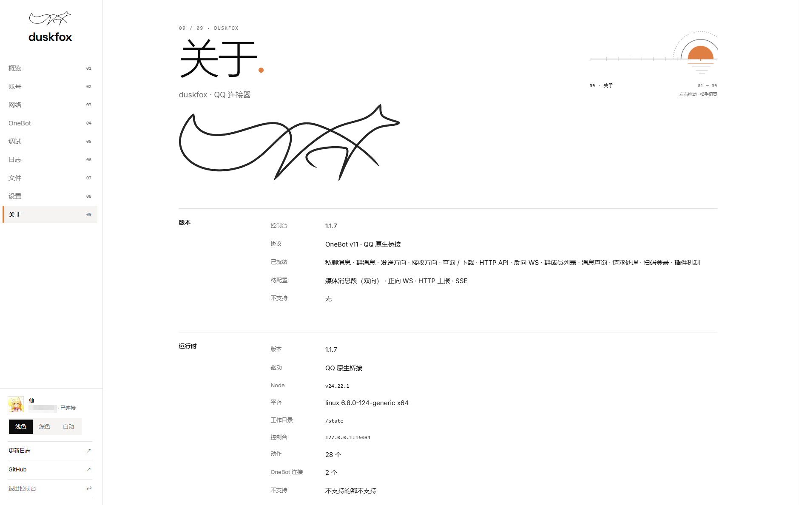

# DuskFox

（双进程登录）在 Linux Docker 里跑官方 QQ 客户端，把消息转成 OneBot v11，给 AstrBot 这类框架用，另外带一个网页控制台。

目前是 Linux x86_64 的内测阶段，建议用测试号，机器留 2 GiB 以上可用内存。

这个项目跟腾讯没有隶属或授权关系，仅供学习研究使用。往 QQ 客户端里注入进程可能违反腾讯的用户协议，后果自负。

## 启动

```bash
git clone https://github.com/Seeeaa/DuskFox.git
cd DuskFox
docker compose -f deploy/linux/compose.yaml up -d --build
docker compose -f deploy/linux/compose.yaml exec -T fox node -p "JSON.parse(require('fs').readFileSync('/state/config/webui.json','utf8')).token"
```

最后一条命令输出的令牌用来登录 `http://127.0.0.1:16084/`，进去以后在账号页扫码。服务器不在本机的话，用 SSH 隧道把 16084 和 13000 转出来。

OneBot 的 HTTP 和 WebSocket 默认开在本机 13000，把地址和配置里那枚令牌填到框架的适配器里就能连。

构建时会从 QQ 官方地址下载固定版本的客户端，所以要能连外网。下载不通的话，可以参考 deploy/linux/README.md 自己放一份同版本的 QQ.deb。

## 界面

左边是导航，右边是内容，概览页这一屏就能看出运行状态。


关于页列出当前版本、支持的能力，以及运行时信息。



## 现在能用的部分

文字、图片、语音、文件、视频和合并转发都已经接上，消息 ID、统计、请求事件、扫码状态这些也在。每项功能在真实 QQ 上验证到什么程度，以 docs/feature-gap.md 为准，那里写的是实际情况。

## 邮件提醒

控制台设置页可以填自己的 SMTP 主机、账号和授权码，上线、掉线、运行错误三种提醒能分别打开。邮件由 Fox 进程直接发，QQ 掉线时也能发出去。

## 文档

[安装与本地演示](docs/install.md) · [Docker 部署](deploy/linux/README.md) · [运行时接口](docs/native-runtime.md) · [能力现状](docs/feature-gap.md) · [许可](LICENSE)
