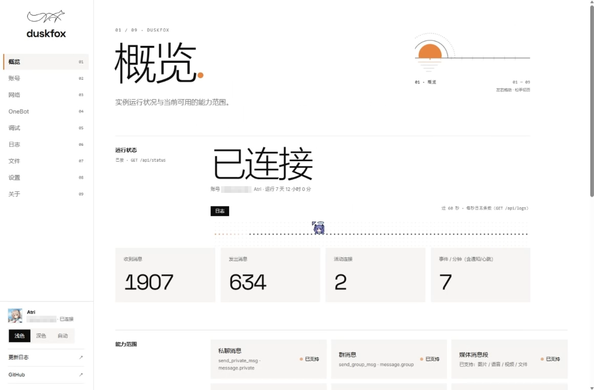
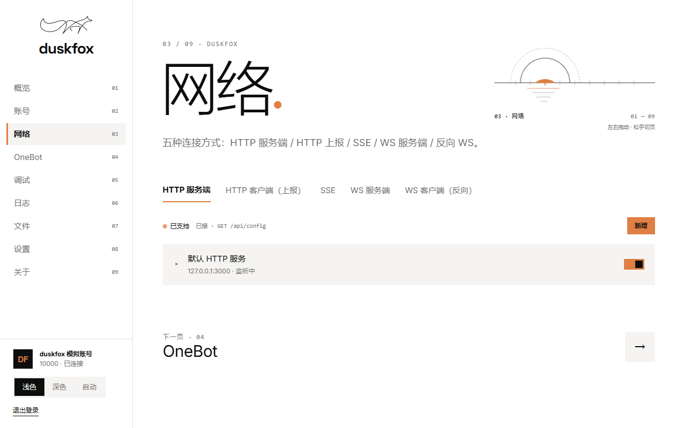
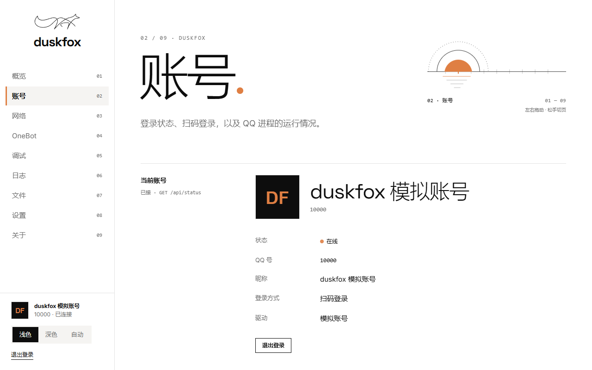
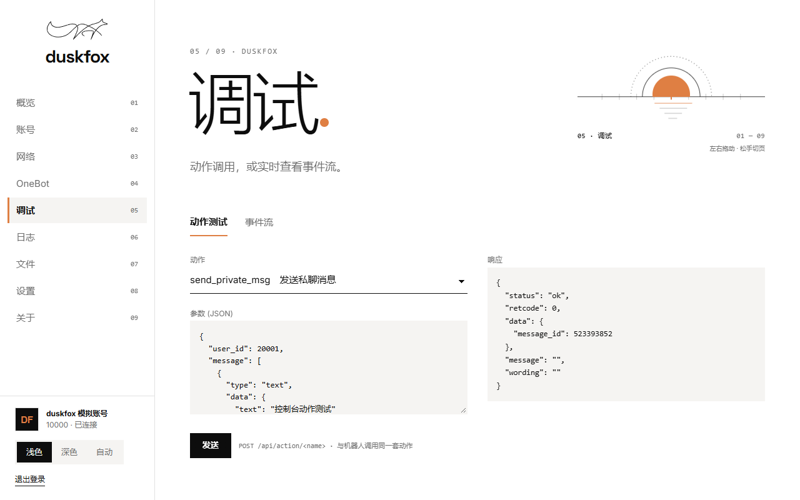

# duskfox

跨平台（Windows / Linux）的 **QQ → OneBot v11 连接器框架**，自带一套深色/浅色管理控制台。
架构参考 NapCat 的分层思路：驱动层负责“把 QQ 变成可调用的事件源”，OneBot 层负责协议与网络，
控制台层负责运维，三者通过明确定义的接口解耦。

> 当前状态：协议层、网络层、控制台、插件、配置热重载与测试均已完成并验证；
> QQ 本体通过 `driver` 接入。仓库自带 `mock`（本地模拟账号，用于联调）与
> `bridge`（连接独立的 QQ 原生运行时，HTTP 契约）两个驱动。
> 真实 QQ 会话需要原生运行时，本仓库不包含它，也不修改任何 QQ 客户端。

---

## 1. 能力一览

| 能力 | 状态 |
|---|---|
| OneBot v11 HTTP API（动作 + 鉴权 + CORS） | 已实现 |
| 反向 WebSocket（ws-client） | 已实现 |
| 正向 WebSocket（ws-server） | 已实现 |
| HTTP POST 事件上报（http-client） | 已实现 |
| SSE 事件流 | 已实现 |
| 消息段数组 / CQ 码字符串两种格式 | 已实现 |
| 事件：message.private / message.group / meta_event / notice / request | 已实现 |
| 动作：13 个（登录信息、状态、版本、发送私聊/群、撤回、好友/群列表…） | 已实现 |
| 配置热重载（改端口才重启监听，改令牌不踢连接） | 已实现 |
| 管理控制台（令牌登录、9 个页面、SSE 实时日志与事件） | 已实现 |
| 插件（进程内 ESM，事件钩子 + 动作调用） | 已实现 |
| 模拟账号驱动（无需 QQ 即可全链路联调） | 已实现 |
| 原生桥接驱动（连接外部 QQ 运行时） | 已实现，需外部运行时 |
| 真实 QQ 会话 / 扫码登录 | 依赖原生运行时，未随仓库提供 |
| 群成员列表、合并转发、富媒体收发 | 未实现（动作会明确返回 1200/1404） |

## 2. 快速开始

要求：Node.js ≥ 20.11（开发脚本跑 TypeScript 需要 ≥ 22.18；发行版走编译后的 `dist`）。

```bash
git clone <repo> duskfox && cd duskfox
npm install

# 开发：直接运行 TypeScript
npm run dev -- --workdir ./_run --port 6099

# 生产：先构建再运行
npm run build
npm start -- --workdir ./_run --port 6099
```

Windows（PowerShell）与 Linux 命令相同，只有路径写法不同：

```powershell
node dist\main.js --workdir D:\duskfox --port 6099 --driver mock
```

首次启动会：

1. 在 `<工作目录>/config/` 下生成 `webui.json`、`onebot.json`、`network.json`；
2. 生成 32 位随机管理令牌写入 `webui.json`（文件权限 0600）；
3. 打开控制台 `http://127.0.0.1:6099`，用该令牌登录。

```bash
cat ~/.duskfox/config/webui.json     # Linux
type %USERPROFILE%\.duskfox\config\webui.json   # Windows
```

### 常用启动参数

| 参数 | 说明 |
|---|---|
| `-w, --workdir <目录>` | 实例工作目录（默认 `~/.duskfox`，或 `DUSKFOX_WORKDIR`） |
| `--driver <mock\|bridge>` | 账号驱动，默认 `mock` |
| `--host / -p, --port` | 覆盖控制台监听地址 / 端口（端口 0 表示随机） |
| `--bridge-url / --bridge-token` | 原生桥接服务地址与令牌 |
| `--simulate` | mock 驱动周期产生模拟入站消息（联调用） |
| `--no-auto-login` | mock 驱动启动后不自动登录 |
| `--log-level <debug\|info\|warn\|error>` | 日志级别 |

停止：`Ctrl+C` 或 `SIGTERM`，会先关闭监听再退出。

## 3. 工作目录布局

```
<workdir>/
  config/webui.json     控制台监听、管理令牌、会话时长、IP 白名单
  config/onebot.json    OneBot 行为（消息格式、心跳、ID 策略、事件过滤）
  config/network.json   五种连接方式的实例列表
  logs/duskfox-YYYY-MM-DD.log   JSONL 日志，按天滚动，保留 14 天
  cache/                二维码、临时文件、instance.json（运行中的端口发现文件）
  data/                 驱动与插件的数据目录
  plugins/*.mjs         进程内插件
```

## 4. 配置

### 4.1 `network.json`

五种连接按关键字分组，每一项都有稳定 `id`（保存时自动生成）：

```json
{
  "http-server": [{ "id": "http-server_ab12cd34", "name": "默认 HTTP 服务", "enabled": true,
                    "host": "127.0.0.1", "port": 3000, "token": "", "cors": false, "enableWs": true }],
  "http-client": [{ "name": "上报", "enabled": false, "url": "", "token": "", "timeout": 5000, "retries": 2 }],
  "sse":         [{ "name": "SSE", "enabled": false, "host": "127.0.0.1", "port": 3001, "token": "" }],
  "ws-server":   [{ "name": "正向 WS", "enabled": false, "host": "127.0.0.1", "port": 3002, "token": "" }],
  "ws-client":   [{ "name": "Bot 框架", "enabled": true, "url": "ws://127.0.0.1:6700/onebot/v11/ws",
                    "token": "", "heartbeat": 30000, "reconnect": 5000 }]
}
```

- `port: 0` 让系统分配端口（测试与容器环境常用），实际端口可在 `GET /api/status` 的
  `onebot.connections[].address` 里查到。
- `token` 为空表示该连接不鉴权；**只建议在绑定 127.0.0.1 时这样用**。
- 文件支持 JSON5（注释、尾逗号），保存时会被规范化成标准 JSON。

### 4.2 `onebot.json`

| 字段 | 默认 | 说明 |
|---|---|---|
| `messagePostFormat` | `array` | `array` 发消息段数组，`string` 发 CQ 码字符串 |
| `reportSelfMessage` | `false` | 是否把本账号发出的消息也作为 message 事件推送 |
| `heartbeatIntervalMs` | `30000` | heartbeat 元事件间隔 |
| `messageIdMode` | `hash` | 数字 message_id 的生成方式（哈希稳定 / 自增序号） |
| `debug` | `false` | 事件里附带驱动原始负载 `raw` |
| `events.*` | 全 `true` | 私聊、群、元事件、通知、请求的开关 |

### 4.3 `webui.json`

| 字段 | 默认 | 说明 |
|---|---|---|
| `host` | `127.0.0.1` | 控制台监听地址 |
| `port` | `6099` | 控制台端口 |
| `token` | 随机 | 管理令牌；登录后换发短期会话令牌 |
| `sessionMinutes` | `120` | 会话空闲超时，0 表示不过期 |
| `allowlist` | `[]` | 允许访问控制台的来源地址；空表示不限制 |

## 界面

设计稿（v12，未接线）保存在 `webui/design/duskfox-webui-v12-original.html`，
接线后的控制台是 `webui/index.html`（同一套视觉与页面，数据全部来自真实接口）。






## 5. 控制台

`http://<host>:<port>/#/overview`，令牌登录，会话令牌只存在 `sessionStorage`。

| 页面 | 数据来源 |
|---|---|
| 概览 | `/api/status`、`/api/events`、SSE 指示灯 |
| 账号 | 账号状态、`/api/qr`（扫码登录）、`/api/process`（进程信息与启停） |
| 网络 | `/api/config` 读取，`PUT /api/config` 写入并热重载五种连接 |
| OneBot | 消息格式、ID 策略、心跳、事件过滤，保存即生效 |
| 调试 | `/api/actions` 列出动作，`POST /api/action/<name>` 真实调用并显示响应 |
| 日志 | `/api/logs` + SSE `log` 事件，支持级别过滤、搜索、下载 |
| 文件 | `/api/files` 只读浏览工作目录，`/api/files/read` 预览文本 |
| 设置 | 外观本地保存；存储占用、清理、导出/导入/恢复、令牌轮换走 API |
| 关于 | 版本、运行时、接口接入对照（`wired` 标记来自服务端） |

界面上的“已接 / 待接入”标记、能力表、进程信息全部来自真实接口；没有对应能力时会显示
“暂不支持”或“未配置”，不会伪造数据。

## 6. OneBot v11

### 6.1 传输

| 类型 | 行为 |
|---|---|
| `http-server` | `POST/GET /<action>`（`/send_msg` 或 `/api/send_msg` 均可）；同一端口可选挂 WS：`/api` 只收发动作，其它路径还会收到事件流 |
| `ws-client` | 主动连接 Bot 框架，握手头 `X-Self-ID`、`X-Client-Role: Universal`，断线按 `reconnect` 指数退避重连 |
| `ws-server` | Bot 连入后立刻收到 `lifecycle.connect`，之后广播事件 |
| `http-client` | 每条事件 POST 到配置的 URL，失败按 `retries` 重试，队列上限 500 条 |
| `sse` | `GET /events` 长连接，`data: <json>`，15 秒一次注释心跳 |

鉴权：`Authorization: Bearer <token>` 或 `?access_token=<token>`；HTTP 失败返回 403，
WebSocket 握手失败直接断开。

### 6.2 动作

`get_login_info`、`get_status`、`get_version_info`、`can_send_image`、`can_send_record`、
`get_friend_list`、`get_group_list`、`get_stranger_info`、`get_group_member_info`、
`send_private_msg`、`send_group_msg`、`send_msg`、`delete_msg`。

- 兼容 `_async`、`_rate_limited` 后缀别名（go-cqhttp 时代习惯）。
- 参数经 TypeBox 校验：字符串数字会自动转换，缺失字段用默认值补齐，错误返回 `retcode: 1400`。
- 驱动不支持的能力由动作声明 `requires` 统一拦截，返回 `retcode: 1200`，错误信息指明缺少的能力。

返回码：`0` 成功、`1200` 不支持、`1400` 参数错误、`1403` 鉴权失败、`1404` 未找到、`1500` 服务端错误。

### 6.3 事件

`message.private/sub_type=friend|self`、`message.group`、`meta_event.lifecycle`、
`meta_event.heartbeat`、`notice.*`（好友/群撤回、进退群、管理变更、上传、禁言）、
`request.*`（加好友、加群）。

`message_id` 是正整数：默认由 `md5(原生id|会话|对象)` 取 31 位得到，稳定可复现；
最近 5000 条保留双向映射，超出后旧 id 会失效（与 NapCat 的设计取舍一致，不做数据库）。

## 7. 驱动

驱动是“把某个 QQ 运行时变成事件源 + 动作执行器”的适配层，接口见
`src/driver/types.ts`。内置两个：

### `mock`（默认）

- 完整模拟登录状态机、二维码、收发消息、好友/群列表、进程信息；
- 二维码是**合成的示意图**，明确标注“不可扫描”，只用于联调界面；
- `--simulate` 会周期性产生入站消息，方便观察事件链路。

### `bridge`

用于把本框架接到一个独立的 QQ 原生运行时（自己负责登录、自己持有会话），通过 HTTP 契约交互：

| 接口 | 方向 | 说明 |
|---|---|---|
| `GET /api/status` | 读 | `{ message_ready, self_id, nickname, pid, cpu, memory_mb, version }` |
| `GET /api/events?after=<cursor>` | 读 | `{ cursor, events: [{ cursor, data }] }`，`data` 为 OneBot 风格事件 |
| `POST /api/send-private` | 写 | `{ user_id, message }` → `{ message_id }` |
| `GET/POST /api/qr[/refresh]` | 读 | `{ picture: base64, expires_at, seq }` |

启动：`node dist/main.js --driver bridge --bridge-url http://127.0.0.1:16082 --bridge-token <token>`。
桥接不可用时，控制台会显示“桥接服务不可用”并在 `/api/status` 的 `account.detail` 里给出原因，
不会阻塞控制台本身。

### 新增驱动

实现 `AccountDriver`，在 `src/driver/registry.ts` 注册即可；控制台、“能力范围”表、
动作可用性都由 `capabilities` 自动推导，不需要改前端。

## 8. 插件

把 `.mjs` / `.js` 放进 `<workdir>/plugins/`，重启实例后加载：

```js
export const version = '1.0.0';
export default function setup(ctx) {
  ctx.logger.info('demo', 'started');
  ctx.onEvent((event) => console.log(event.type, event.summary));
  ctx.call('get_login_info').then((r) => console.log(r.data));
}
```

`ctx` 提供 `id / version / logger / dataDir / onEvent / call`。单个插件抛错只会记录日志并标记
为未激活（控制台 `/api/status` 的 `plugins` 字段），不会影响其它插件与框架。示例见
`examples/plugins/echo-log.mjs`。

## 9. 开发

```bash
npm run typecheck   # 严格模式 TypeScript 检查（含测试）
npm run build       # 输出到 dist/
npm test            # node:test：31 个用例（配置/协议/传输/驱动/插件/控制台）
```

测试覆盖：配置规范化与拒绝非法值、CQ 码往返、消息 ID 映射与淘汰、控制台鉴权与接口、
OneBot HTTP 直连、反向/正向 WS 的动作与事件、桥接驱动契约、插件事件钩子。

## 10. 架构

```
┌──────────────────────── 管理控制台（浏览器） ────────────────────────┐
│  9 个页面 · SSE 实时日志/事件 · 令牌会话                              │
└───────────────────────────────▲──────────────────────────────────────┘
                                │ REST + SSE（Bearer / ?token=）
┌───────────────────────────────┴──────────── src/webui ──────────────┐
│  server · router · routes/* · auth(session) · stream                  │
├──────────────────────────────────────────────────────────────────────┤
│  src/app.ts   组合根：路径/配置/日志/驱动/服务/插件/控制台             │
├──────────────────────────── src/onebot ──────────────────────────────┤
│  service（事件转换 + 动作分发） · actions/* · segments(CQ) · events    │
│  network/*：http-server · ws-client · ws-server · http-client · sse   │
├──────────────────────────── src/core ────────────────────────────────┤
│  config(typebox+JSON5+原子写) · logger(环形+JSONL) · model · stats      │
│  message-id(哈希+LRU) · paths · emitter · tokens                       │
├──────────────────────────── src/driver ──────────────────────────────┤
│  AccountDriver 接口 · mock 驱动 · bridge 驱动 · registry               │
└───────────────────────────────▲──────────────────────────────────────┘
                                │ 事件 / 动作
                     QQ 运行时（原生桥接或模拟）
```

设计要点与取舍见 `docs/architecture.md`。

## 11. 安全

- 管理令牌随机 24 字节、文件 0600；登录后换发短期会话令牌，管理令牌不进入浏览器存储。
- 控制台默认只监听 `127.0.0.1`；改成 `0.0.0.0` 前请先设置强令牌与 IP 白名单。
- 配置导出不包含控制台令牌；日志、事件与控制台的摘要里不写消息正文以外的凭据。
- 文件浏览限定在工作目录内（路径穿越返回 400），只读，二进制不预览。
- 插件运行在框架进程内，等价于代码执行权限，只加载可信文件。

## 12. 未完成 / 下一步

1. 原生 QQ 运行时（扫码登录、真实会话）——当前通过 `bridge` 驱动对接，仓库不含运行时。
2. 群成员列表、合并转发、富媒体（图片/语音/文件）的端到端收发。
3. HTTP POST 上报的双向快速操作（上报响应里回动作）。
4. 通知（上线/掉线/错误）通道，控制台已占位并标注未实现。

## License

MIT，见 `LICENSE`。
